# proxysql-gui

[](https://github.com/drexlma/proxysql-gui/actions/workflows/ci.yml)

Web-Oberfläche für [ProxySQL](https://proxysql.com/) im Stil klassischer Enterprise-Management-Konsolen –
mit Schreibzugriff, Abgleich von Konten und Cluster-Knoten zwischen ProxySQL und MariaDB/MySQL
(per Klick oder automatisch) und Query-Cache per Klick.

Reines PHP ohne Framework, keine externen JavaScript-Bibliotheken und kein CDN (die Diagramme sind selbst
gezeichnetes SVG) – läuft also auch in abgeschotteten Netzen.

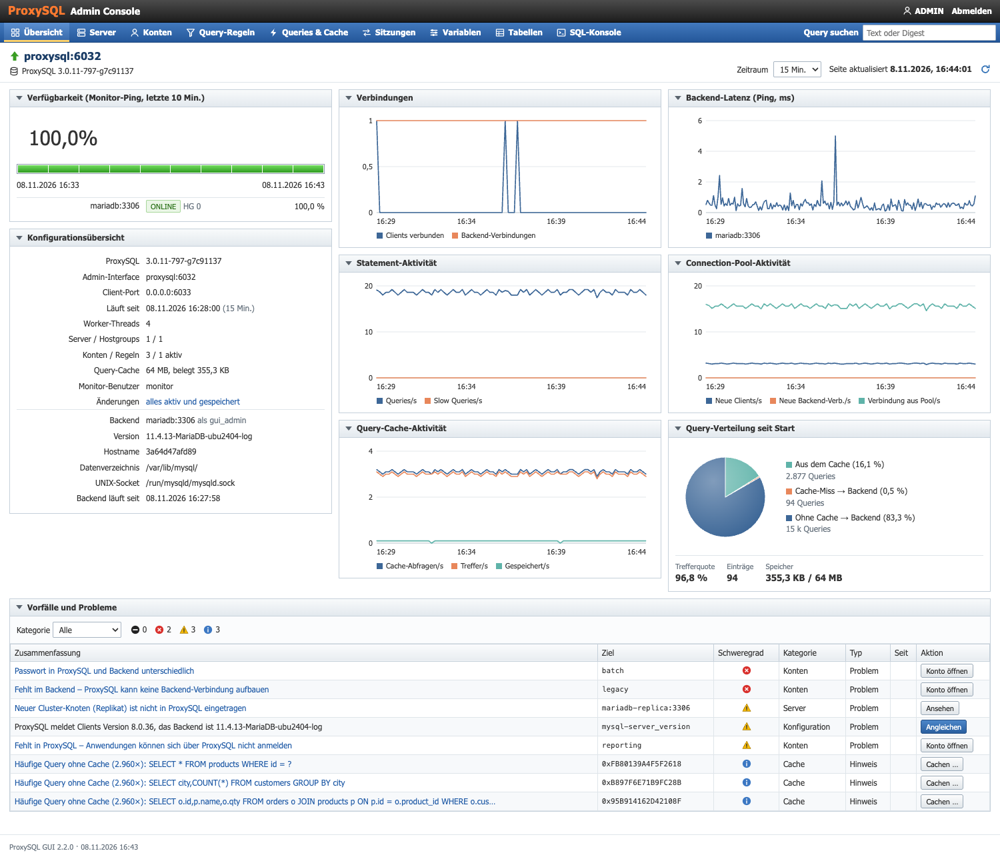

**Inhalt:** [Schnellstart](#schnellstart-mit-docker-test-umgebung) · [Produktion](#produktivbetrieb-mit-docker) · [Funktionen](#funktionen) · [Automatischer Abgleich](#automatischer-abgleich) ·
[Demo durchspielen](#demo-durchspielen) · [Konfiguration](#konfiguration) · [Ohne Docker](#ohne-docker) · [Sicherheit](#sicherheit) ·
[Grenzen](#grenzen) · [Tests](#tests) · [Aufbau](#aufbau)

## Schnellstart mit Docker (Test-Umgebung)

```sh
cp .env.example .env     # Passwörter und Ports anpassen
docker compose up -d --build
```

`docker-compose.yml` ist eine Test- und Demo-Umgebung mit Demo-Passwörtern, Testdaten und eingebauten Problemen –
für den Produktivbetrieb gibt es [`docker-compose.prod.yml`](#produktivbetrieb-mit-docker).

| Dienst | Adresse |
| --- | --- |
| GUI | http://localhost:8080 – Login `admin` / `admin-demo`, nur lesen `readonly` / `readonly-demo` (aus `.env`) |
| ProxySQL für Anwendungen | `localhost:6033` |
| ProxySQL-Admin | `127.0.0.1:6032` (nur lokal) |
| MariaDB direkt | `127.0.0.1:3307` (nur lokal) |

Ist ein Port schon belegt, in der `.env` umstellen (`GUI_PORT`, `PROXYSQL_PORT`, `PROXYSQL_ADMIN_PORT`, `MARIADB_PORT`).

Das Beispiel besteht aus MariaDB 11.4 (Primary und ein schreibgeschütztes Replikat) mit einer Demo-Datenbank `shop`,
ProxySQL 3.0, der GUI (PHP 8.3/Apache) und einem kleinen Lastgenerator, damit Diagramme und Digests sofort Daten zeigen
(`docker compose stop loadgen` schaltet ihn ab). Der Sync-Container für den
[automatischen Abgleich](#automatischer-abgleich) startet nur mit dem Profil `sync`.

**Wichtig:** ProxySQL liest `proxysql.cnf` und MariaDB die Init-Skripte nur beim allerersten Start.
Danach gilt der Stand in den Volumes. Neu aufsetzen (löscht alle Daten): `docker compose down -v && docker compose up -d`.
Das ist auch nötig, wenn ein älterer Stand des Beispiels (ohne Replikat) schon läuft.

## Produktivbetrieb mit Docker

`docker-compose.prod.yml` enthält nichts aus dem Demo – keine Testdatenbank, keine Demo-Konten, keine Standardpasswörter.

```sh
cp .env.prod.example .env.prod      # Werte eintragen
docker compose -f docker-compose.prod.yml --env-file .env.prod up -d --build
```

| | GUI gegen bestehendes ProxySQL (Standard) | ProxySQL mitbetreiben (`COMPOSE_PROFILES=proxysql`) |
| --- | --- | --- |
| Container | `gui` (+ `sync`) | `gui`, `proxysql` (+ `sync`) |
| `PROXYSQL_HOST` | Host/IP des bestehenden ProxySQL | `proxysql` |
| Vorbereitung | zweiter Admin-Benutzer in ProxySQL (siehe unten) | keine: `radmin` mit `PROXYSQL_PASSWORD` und `BACKEND_HOST` als Primary werden beim ersten Start eingetragen |

Für Kontenabgleich und Cluster-Erkennung braucht die GUI einen Backend-Benutzer, bei einem bestehenden ProxySQL
außerdem einen Admin-Benutzer, der sich übers Netz anmelden darf (`admin` darf nur lokal):

```sql
-- MariaDB/MySQL
CREATE USER 'gui_admin'@'%' IDENTIFIED BY '…';
GRANT ALL PRIVILEGES ON *.* TO 'gui_admin'@'%' WITH GRANT OPTION;

-- ProxySQL-Admin-Interface (Port 6032)
UPDATE global_variables SET variable_value = 'admin:…;radmin:…' WHERE variable_name = 'admin-admin_credentials';
LOAD ADMIN VARIABLES TO RUNTIME; SAVE ADMIN VARIABLES TO DISK;
```

Fehlt der Monitor-Benutzer im Backend, legt die GUI ihn auf Knopfdruck an.

Unterschiede zum Test-Setup:

- **Pflichtwerte:** ohne `GUI_PASSWORD`, `PROXYSQL_HOST` und `PROXYSQL_PASSWORD` bricht Compose mit einer Meldung ab,
  mit Profil `proxysql` zusätzlich ohne `BACKEND_HOST` und `MONITOR_PASSWORD`.
- **Erreichbarkeit:** Die GUI lauscht nur auf `127.0.0.1` (`GUI_BIND`); HTTPS übernimmt ein Reverse-Proxy davor
  (nginx, Caddy, Traefik …). Setzt er `X-Forwarded-Proto: https`, wird das Session-Cookie als `Secure` markiert.
  Das ProxySQL-Admin-Interface bleibt im Compose-Netz, Anwendungen nutzen `PROXYSQL_APP_PORT` (6033).
- **Container:** Der Code steckt im Image statt live eingebunden. Schreibgeschütztes Dateisystem, alle Linux-Rechte
  entzogen bis auf die drei, die Apache braucht, `no-new-privileges`, Healthchecks.
- **Logs** gehen an Syslog, markiert mit Image, Container-Name und -ID: standardmäßig an den des Hosts (`/dev/log`,
  also rsyslog oder journald), mit `SYSLOG_ADDRESS` an einen zentralen Server. `docker compose logs` funktioniert weiter.
  Docker Desktop (macOS/Windows) hat keinen lokalen Syslog – zum Ausprobieren dort `SYSLOG_ADDRESS` setzen.
- **ProxySQL** startet ohne Konten und Regeln (`docker/proxysql/proxysql.prod.cnf.tpl`): Konten kommen über
  *Konten → Abgleich* oder `AUTO_SYNC=users,passwords`, weitere Knoten über *Server → Cluster* oder `AUTO_SYNC=cluster`.

Aktualisieren: `git pull && docker compose -f docker-compose.prod.yml --env-file .env.prod up -d --build`.
Mit Profil `proxysql` liegt die Konfiguration im Volume `proxysql-gui-prod_proxysql-data` – das gehört ins Backup.

## Funktionen

### Übersicht

Aufgebaut wie die MySQL-Seite im Oracle Enterprise Manager (Bild oben):

- **Verfügbarkeit** der Backends aus dem Monitor-Ping der letzten 10 Minuten
- **Konfigurationsübersicht** von ProxySQL und Backend (Version, Threads, Server, Konten, Regeln, Cache, Monitor-Benutzer)
- **Live-Diagramme** für Verbindungen, Queries/s, Query-Cache, Backend-Latenz und Connection-Pool, Zeitraum von 15 Minuten bis 7 Tage
- **Query-Verteilung**: welcher Anteil aus dem Cache kommt und welcher ans Backend geht
- **Vorfälle und Probleme** mit Schweregrad und Direkt-Aktion: Server nicht ONLINE, Monitor-Fehler, fehlender Monitor-Benutzer,
  Kontenprobleme, neue oder verschwundene Cluster-Knoten, eine Server-Version, die nicht zum Backend passt,
  Regeln auf leere Hostgroups, nicht aktivierte oder nicht gespeicherte Konfiguration,
  Cache-Regeln ohne Treffer und häufige Queries, die sich zum Cachen eignen

### Konten

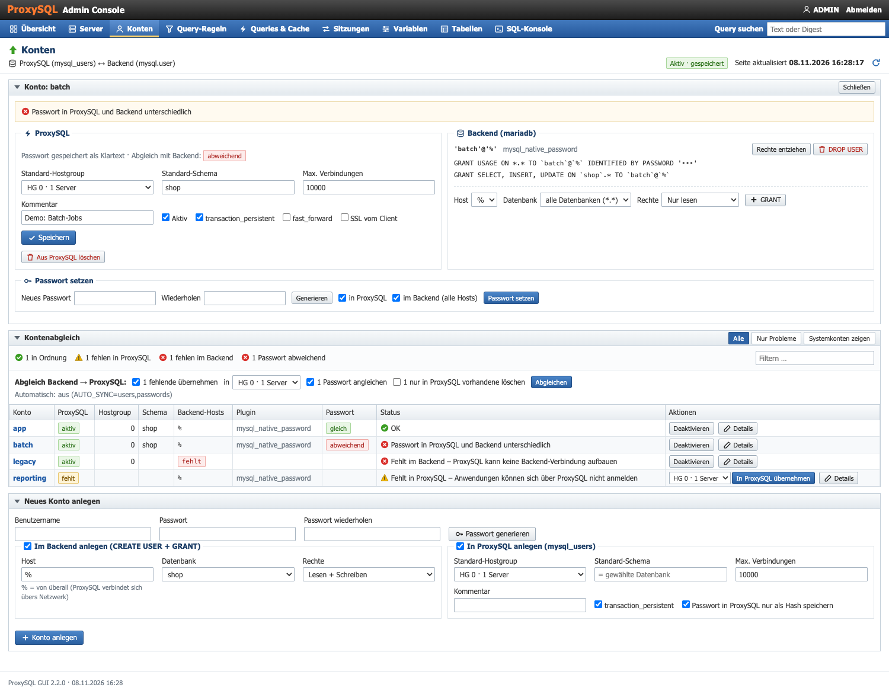

Abgleich von `mysql_users` (ProxySQL) mit `mysql.user` (MariaDB/MySQL):

- erkennt Konten, die **in ProxySQL fehlen** oder **im Backend fehlen**, **abweichende Passwörter**
  (Vergleich über den `mysql_native_password`-Hash), Konten nur für `localhost` und Standard-Hostgroups ohne ONLINE-Server
- **Konto in beiden Systemen anlegen**: `CREATE USER` + `GRANT` im Backend und Eintrag in ProxySQL, mit Rechte-Vorlagen
  (nur lesen, lesen + schreiben, schreiben + DDL, alle Rechte)
- Backend-Konto mit einem Klick **nach ProxySQL übernehmen** – der Passwort-Hash wird kopiert, das Passwort muss nicht bekannt sein
- **Abgleich Backend → ProxySQL in einem Rutsch** (wie `proxysql-admin --syncusers`): alle fehlenden Konten übernehmen,
  abweichende Passwörter aus dem Backend angleichen und auf Wunsch Konten löschen, die es nur in ProxySQL gibt.
  Übernommen wird immer der Hash. Konten mit anderem Anmeldeverfahren (`caching_sha2_password`, `ed25519`,
  `unix_socket`), unterschiedlichen Passwörtern je Host oder nur für `localhost` werden mit Grund übersprungen.
  Reine Replikationskonten zählen als Systemkonten.
- fehlendes Backend-Konto aus ProxySQL heraus anlegen, Passwort in beiden Systemen gleichzeitig setzen,
  Rechte vergeben und entziehen, Konten löschen; `SHOW GRANTS` wird ohne Hashes angezeigt

### Queries & Cache

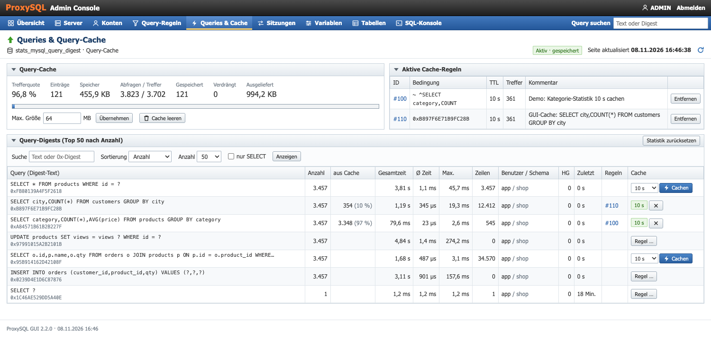

- Query-Digests mit Anzahl, Laufzeiten, Zeilen und Anteil aus dem Cache, sortier- und filterbar
- Die Regelkette wird für jeden Digest simuliert (Reihenfolge, `flagIN`/`flagOUT`, `apply`): die Spalte *Regeln* zeigt,
  welche Regeln greifen, die Spalte *Cache* die wirksame TTL
- **„Cachen“** legt mit einem Klick eine Cache-Regel für genau diesen Digest an und sortiert sie automatisch vor eine
  `apply`-Regel ein, die sonst vorher greifen würde
- Cache-Größe ändern, Cache leeren, Digest-Statistik zurücksetzen

### Query-Regeln

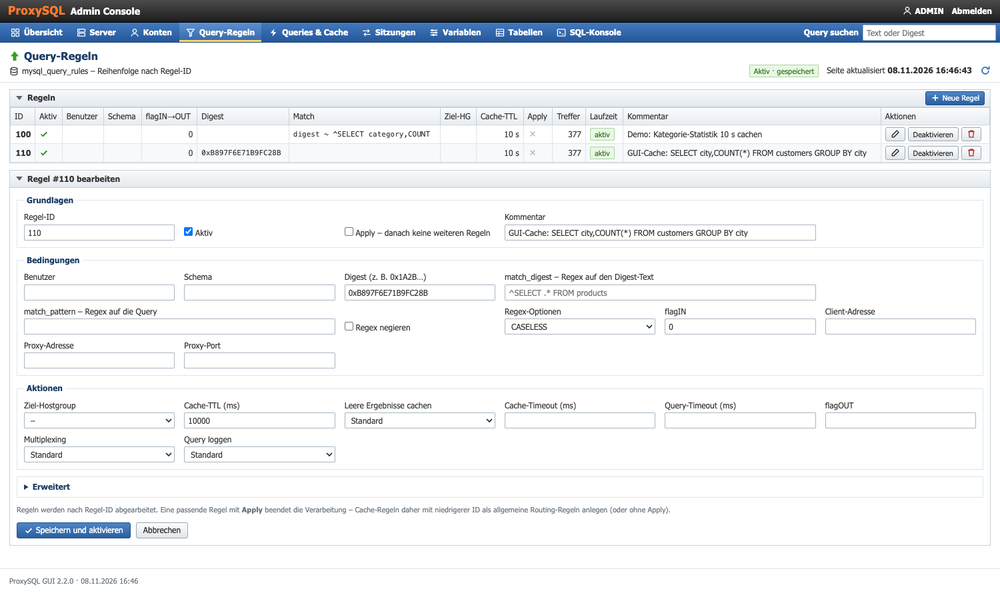

Alle Felder von `mysql_query_rules`, gruppiert nach Bedingungen, Aktionen und Erweitert. Die Liste zeigt Treffer
und ob eine Regel schon aktiv ist. Regeln lassen sich an- und abschalten und löschen.

### Server, Sitzungen, Variablen, SQL-Konsole

| Server | Sitzungen |
| --- | --- |
| 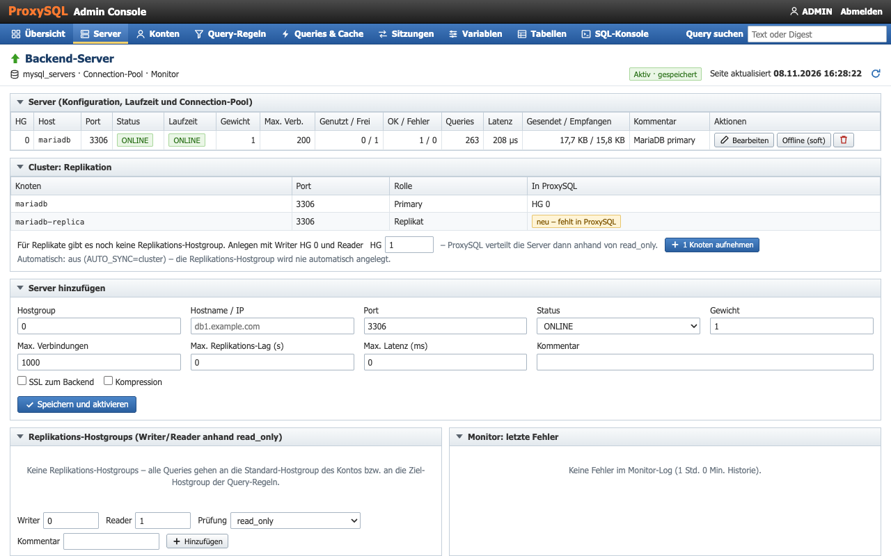 | 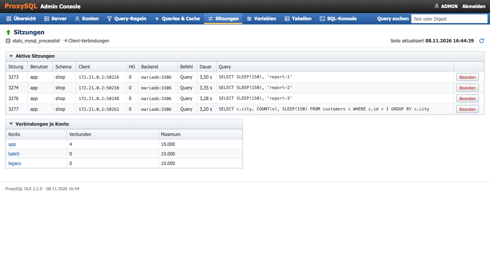 |
| **Variablen** | **SQL-Konsole** |
| 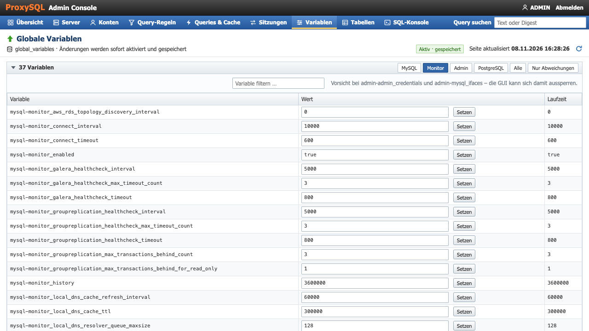 | 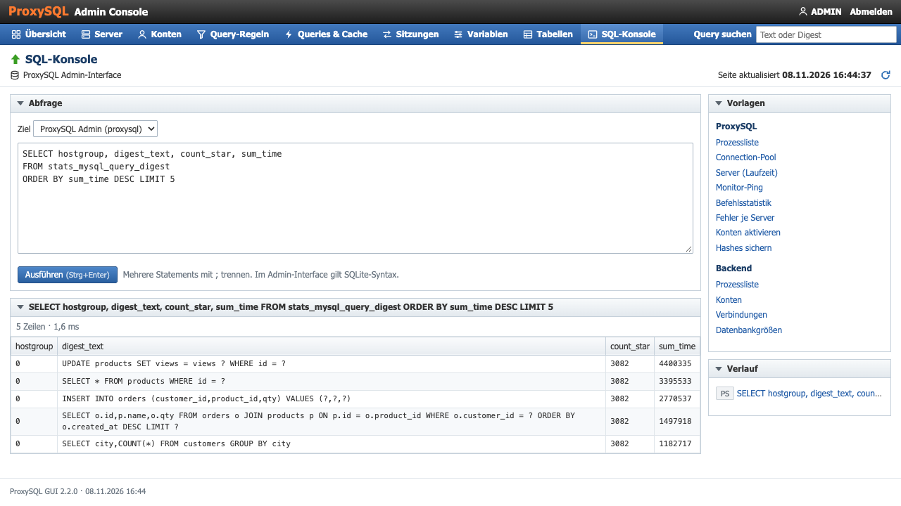 |

- **Server**: `mysql_servers` mit Laufzeit-Status und Connection-Pool, Online/Offline schalten,
  Replikations-Hostgroups, letzte Monitor-Fehler und die **Cluster-Erkennung** (wie `proxysql-admin --update-cluster`):
  Replikate, die beim Backend angemeldet sind, Galera- und Group-Replication-Knoten werden mit `mysql_servers` verglichen.
  Neue Knoten lassen sich mit einem Klick aufnehmen; fehlt für Replikate noch eine Replikations-Hostgroup, wird sie dabei
  angelegt. Eingetragene Server, die nicht mehr im Cluster sind, werden angezeigt und lassen sich austragen.
  Außerdem lässt sich die Version, die ProxySQL den Clients meldet (`mysql-server_version`), an das Backend angleichen.
- **Sitzungen**: Prozessliste, Sitzungen beenden, Verbindungen je Konto
- **Variablen**: `global_variables` filtern und ändern, Abweichungen zwischen Konfiguration und Laufzeit
- **SQL-Konsole**: für das ProxySQL-Admin-Interface und das Backend, mit Vorlagen und Verlauf

### Weitere Tabellen

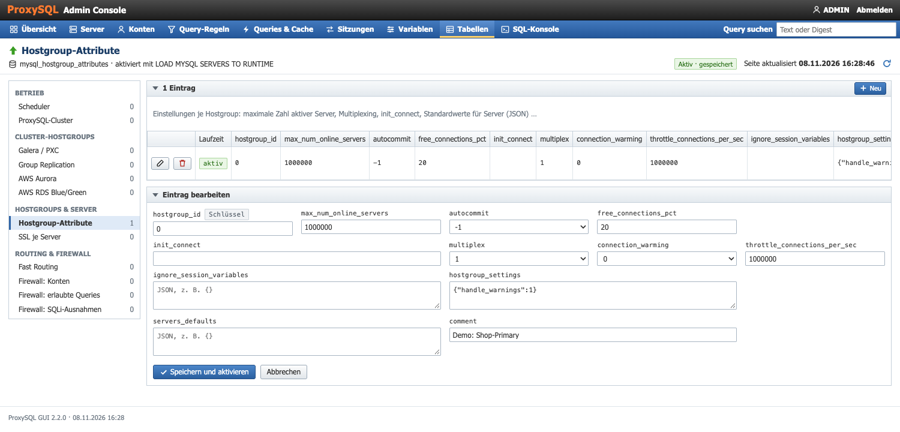

Für alles ohne eigene Seite: Scheduler, ProxySQL-Cluster (`proxysql_servers`), Galera-, Group-Replication-,
Aurora- und RDS-Blue/Green-Hostgroups, Hostgroup-Attribute, SSL je Server, Fast Routing und die Firewall-Tabellen.
Formulare, Auswahllisten und Pflichtfelder entstehen aus dem Tabellenschema von ProxySQL, Fehler meldet ProxySQL
direkt zurück. Jede Zeile zeigt, ob sie schon aktiv ist.

### Konfigurationsabgleich

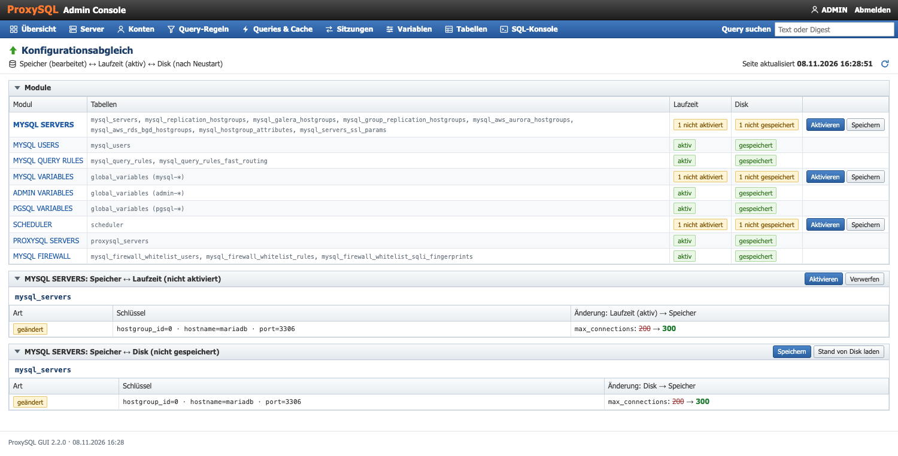

Jede Änderung über die GUI wird sofort aktiviert (`LOAD … TO RUNTIME`) und gespeichert (`SAVE … TO DISK`).
Wird an der GUI vorbei im Admin-Interface etwas geändert, vergleicht die GUI Speicher, Laufzeit und Disk für alle
Konfigurationstabellen und zeigt Zeile für Zeile, was neu, gelöscht oder geändert ist – je Spalte mit alt → neu.
Von dort lässt sich aktivieren, speichern oder verwerfen (Stand der Laufzeit bzw. von Disk zurückholen).
Passwörter und geheime Variablen werden dabei nicht angezeigt.

### Auf dem Handy

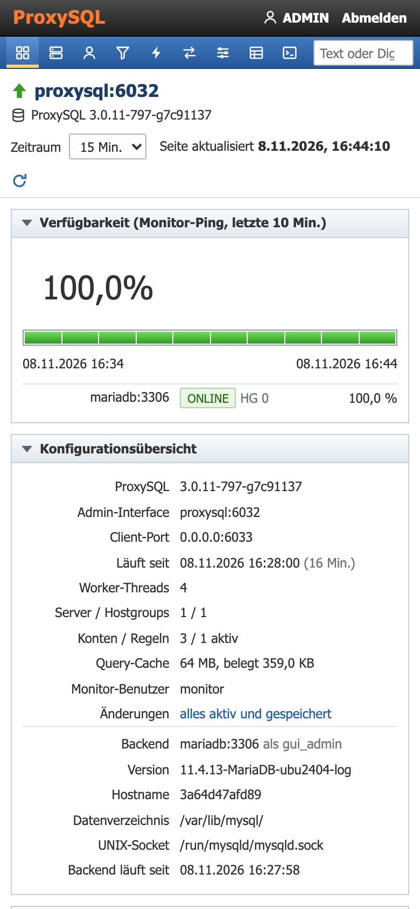

## Automatischer Abgleich

Standardmäßig zeigt die GUI Abweichungen nur an, übernommen wird per Klick. Was zusätzlich automatisch passieren soll,
steht in `AUTO_SYNC` (kommagetrennt):

| Teil | Was passiert |
| --- | --- |
| `users` | Konten, die nur im Backend existieren, werden mit ihrem Passwort-Hash nach ProxySQL übernommen. |
| `passwords` | Weicht ein Passwort ab, bekommt ProxySQL den Hash aus dem Backend. |
| `cluster` | Neue Cluster-Knoten werden in die passende Hostgroup eingetragen. |

Gelöscht wird nie automatisch, und eine fehlende Replikations-Hostgroup wird nie automatisch angelegt (das ändert das
Routing) – beides nur per Klick. Den Abgleich erledigt `src/bin/sync.php`; es schreibt nur dann etwas ins Log, wenn
sich etwas geändert hat oder etwas nicht ging.

Mit Docker in der `.env`:

```sh
AUTO_SYNC=users,passwords,cluster
SYNC_INTERVAL=60
COMPOSE_PROFILES=sync
```

Danach `docker compose up -d`; das Log zeigt `docker compose logs -f sync`. Ohne Docker per Cronjob:

```sh
* * * * *  AUTO_SYNC=users,passwords,cluster php /pfad/zu/src/bin/sync.php >> /var/log/proxysql-gui-sync.log 2>&1
```

## Demo durchspielen

Der Docker-Stack startet mit ein paar absichtlich eingebauten Problemen, die die GUI direkt meldet:

| Wo | Problem |
| --- | --- |
| Konto `reporting` | existiert nur in MariaDB → „Fehlt in ProxySQL“ |
| Konto `legacy` | existiert nur in ProxySQL → „Fehlt im Backend“ |
| Konto `batch` | unterschiedliche Passwörter → „Passwort weicht ab“ |
| `mariadb-replica` | Replikat läuft, steht aber nicht in ProxySQL → „Neuer Cluster-Knoten“ |
| `mysql-server_version` | ProxySQL meldet 8.0.36, das Backend ist MariaDB 11.4 |

Außerdem schlägt die Übersicht häufige Queries ohne Cache als Kandidaten vor.

1. **Konten**: unter *Konten* → *Abgleich Backend → ProxySQL* bei „1 fehlende übernehmen“ und „1 Passwort angleichen“
   *Abgleichen* klicken. `reporting` wird mit dem Hash aus MariaDB angelegt, `batch` bekommt das Backend-Passwort:
   ```sh
   docker compose exec mariadb mariadb -hproxysql -P6033 --skip-ssl -ureporting -preporting-demo shop -e 'SELECT COUNT(*) FROM products'
   docker compose exec mariadb mariadb -hproxysql -P6033 --skip-ssl -ubatch -pneues-passwort shop -e 'SELECT COUNT(*) FROM products'
   ```
2. **`legacy`**: Konto öffnen → *Im Backend anlegen*, Passwortfeld leer lassen (wird aus ProxySQL übernommen), Rechte z. B. „Nur lesen“.
3. **Replikat**: unter *Server* → *Cluster* *1 Knoten aufnehmen*. Die GUI legt die Replikations-Hostgroup 0 → 1 an und trägt
   `mariadb-replica` als Reader ein.
4. **Server-Version**: in der Übersicht beim Vorfall *Angleichen*.
5. **Cache**: unter *Queries & Cache* bei `SELECT city,COUNT(*) FROM customers GROUP BY city` eine TTL wählen und *Cachen*.
   Nach ein paar Sekunden steigen die Spalte *aus Cache* und die Trefferquote, im Diagramm „Query-Verteilung“ wächst der Cache-Anteil.

## Konfiguration

Alles über Umgebungsvariablen (siehe `docker-compose.yml`):

| Variable | Bedeutung |
| --- | --- |
| `PROXYSQL_HOST`, `PROXYSQL_PORT`, `PROXYSQL_USER`, `PROXYSQL_PASSWORD` | ProxySQL-Admin-Interface. Der Benutzer `admin` darf sich nur lokal anmelden – für die GUI einen zweiten Admin-Benutzer in `admin-admin_credentials` eintragen. |
| `BACKEND_HOST`, `BACKEND_PORT`, `BACKEND_USER`, `BACKEND_PASSWORD` | Backend für Kontenabgleich und -verwaltung. Leer = Funktion aus. Der Benutzer braucht `CREATE USER` und die zu vergebenden Rechte `WITH GRANT OPTION`. |
| `GUI_USER`, `GUI_PASSWORD` | Login. **Ohne Passwort gibt es keinen Login und die GUI ist nur lesend.** |
| `GUI_READONLY=1` | Nur-Lesen-Modus trotz Login (Konsole erlaubt dann nur SELECT/SHOW). |
| `GUI_READONLY_USER`, `GUI_READONLY_PASSWORD` | Zweites Login nur zum Lesen (Benutzer standardmäßig `readonly`): sieht alles außer Passwörtern, ohne SQL-Konsole. Ohne Passwort gibt es dieses Login nicht. |
| `SAVE_TO_DISK=0` | Änderungen nur aktivieren, nicht auf Disk speichern. |
| `IGNORE_USERS` | Backend-Konten, die beim Abgleich ausgeblendet werden (Monitor- und GUI-Benutzer sowie reine Replikationskonten kommen automatisch dazu). |
| `AUTO_SYNC` | Automatischer Abgleich durch `bin/sync.php`: `users`, `passwords`, `cluster` (siehe [oben](#automatischer-abgleich)). Leer = nur anzeigen. |
| `SYNC_INTERVAL` | Abstand der Läufe im Sync-Container in Sekunden (Standard 60). |
| `SYNC_HOSTGROUP` | Standard-Hostgroup für übernommene Konten. Leer = die Hostgroup, in der das Backend als Writer eingetragen ist. |
| `GUI_REFRESH` | Aktualisierung der Diagramme in Sekunden (Standard 15). |
| `GUI_BIND`, `GUI_PORT` | Adresse und Port der GUI auf dem Host (Prod: standardmäßig nur `127.0.0.1:8080`). |
| `PROXYSQL_BIND`, `PROXYSQL_APP_PORT`, `MONITOR_USER`, `MONITOR_PASSWORD`, `MYSQL_SERVER_VERSION` | Nur Prod mit Profil `proxysql`: Port für Anwendungen, Monitor-Benutzer und die Version, die ProxySQL den Clients meldet. Gelten nur beim ersten Start. |
| `GUI_IMAGE_TAG` | Nur Prod: Tag des gebauten GUI-Images (Standard `latest`). |
| `SYSLOG_ADDRESS` | Nur Prod: Ziel der Logs, z. B. `tcp://logs.example.com:514`. Leer = Syslog des Hosts (`/dev/log`). |

Für die Diagramme nutzt die GUI `stats_history` von ProxySQL. Die Historie wird standardmäßig nur alle 60 s
geschrieben; im Beispiel ist sie auf 10 s gestellt (`admin-stats_mysql_connections` usw.).
Die Backend-Latenz kommt aus dem Ping-Log des Monitors. Wie weit es zurückreicht, bestimmt `mysql-monitor_history`
(im Beispiel 1 Stunde).

## Ohne Docker

Voraussetzung: PHP ≥ 8.1 mit `mysqli`, ein Webserver mit Document-Root auf `src/`.

1. `src/config.local.php` anlegen:
   ```php
   <?php
   return [
       'proxysql'     => ['host' => '127.0.0.1', 'port' => 6032, 'user' => 'radmin', 'password' => '…'],
       'backend'      => ['host' => '10.0.0.5', 'user' => 'gui_admin', 'password' => '…'],
       'gui_password' => '…',
   ];
   ```
2. Direkten Zugriff auf `src/lib/`, `src/pages/`, `src/bin/` und `config*.php` sperren (Apache-Beispiel in `docker/gui/Dockerfile`).
3. Optional den automatischen Abgleich als Cronjob einrichten (siehe [oben](#automatischer-abgleich)).

Ein Beispiel für eine klassische ProxySQL-Konfiguration liegt in `proxysql.cnf.example`.

## Sicherheit

Die GUI hat Schreibrechte auf ProxySQL und – mit dem Backend-Benutzer – faktisch Admin-Rechte auf der Datenbank.

- Nicht öffentlich erreichbar machen; HTTPS über einen Reverse-Proxy davor (`docker-compose.prod.yml` bindet die GUI
  dafür nur an `127.0.0.1`).
- Login mit Session, CSRF-Schutz für alle Formulare, alle Ausgaben werden escaped.
- Das ProxySQL-Admin-Interface ist SQLite: Werte werden dafür eigens gequotet (`''` statt `\'`).
- Passwörter werden in Listen nie angezeigt; `SHOW GRANTS` wird ohne Hashes ausgegeben.
- Das Login nur zum Lesen hat keine SQL-Konsole (darüber ließen sich Passwörter auslesen) und bekommt geheime
  Variablen wie `admin-admin_credentials` gar nicht erst ausgeliefert.
- In ProxySQL kann das Passwort als `mysql_native_password`-Hash gespeichert werden (Option beim Anlegen).

## Grenzen

- Getestet mit ProxySQL 3.0.11 und 3.0.12 sowie MariaDB 11.4. Die Compose-Dateien nutzen `proxysql/proxysql:3.0`,
  also jeweils die neueste 3.0.x – `docker compose pull` holt Updates.
- Für MySQL 8 mit `caching_sha2_password` muss ProxySQL das Passwort im Klartext kennen –
  beim Anlegen die Option „nur als Hash speichern“ abwählen. Der Passwortvergleich funktioniert dann nicht.
- Die Kontenverwaltung und die Cluster-Erkennung arbeiten gegen ein Backend. Bei mehreren Clustern hinter einem ProxySQL
  sieht der Abgleich nur das konfigurierte.
- Die Cluster-Erkennung ist mit MariaDB-Replikation getestet; Galera und Group Replication sind nach Dokumentation
  umgesetzt, aber nicht gegen einen echten Cluster getestet. Replikate werden über `SHOW REPLICA HOSTS` gefunden –
  ohne `report_host` auf dem Replikat kennt die GUI nur die IP und nimmt den Port des Primary an.
- Nur MySQL-Protokoll; von den PostgreSQL-Funktionen von ProxySQL 3 sind nur die `pgsql-`-Variablen abgedeckt.

## Tests

GitHub Actions (`.github/workflows/ci.yml`) prüft jeden Push auf `main` und jeden Pull Request:

- PHP-Syntax mit PHP 8.1 und 8.4, ShellCheck, JavaScript-Syntax und beide Compose-Dateien
  (Prod muss ohne Pflichtwerte abbrechen).
- `tests/e2e.sh` startet den Test-Stack und spielt die Demo durch: Logins und Rollen, alle Seiten, gesperrte Pfade,
  Vorfälle, Konfigurationsabgleich, Tabellen, Konten-Abgleich mit echter Anmeldung über ProxySQL, Cluster-Aufnahme,
  Query-Cache, `bin/sync.php` und keine PHP-Warnungen im Log.
- `tests/prod.sh` startet die GUI aus `docker-compose.prod.yml` gegen den Test-Stack: Healthcheck, schreibgeschütztes
  Dateisystem, Syslog, Login, Secure-Cookie hinter HTTPS.

Lokal:

```sh
docker compose up -d --build --wait
tests/e2e.sh && tests/prod.sh       # GUI auf anderem Port: GUI_PORT=8091 tests/e2e.sh
docker compose down -v              # der Test verändert den Demo-Zustand
```

## Aufbau

```
RELEASE-NOTES.md          Änderungen je Version
.github/workflows/ci.yml  Tests in GitHub Actions
tests/                    e2e.sh (Test-Stack), prod.sh (Prod-GUI)
docker-compose.yml        Test-/Demo-Stack (.env.example)
docker-compose.prod.yml   Produktion (.env.prod.example)
docker/                   MariaDB-Init, ProxySQL-Templates (Test, Prod) und Entrypoint, GUI-Image, Lastgenerator
src/index.php             Front-Controller (?page=…)
src/bin/sync.php          automatischer Abgleich (Sync-Container oder Cronjob)
src/config.php            Konfiguration aus Umgebungsvariablen
src/lib/                  bootstrap, db (Verbindungen, Quoting), auth, view (Layout), proxysql, layers (Speicher/Laufzeit/Disk),
                          accounts, rules, sync (Konten-, Cluster- und Versionsabgleich)
src/pages/                eine Datei je Seite, Aktionen per POST/Redirect/GET
src/assets/               app.css, app.js (Diagramme, kleine Helfer)
docs/                     Screenshots
```
