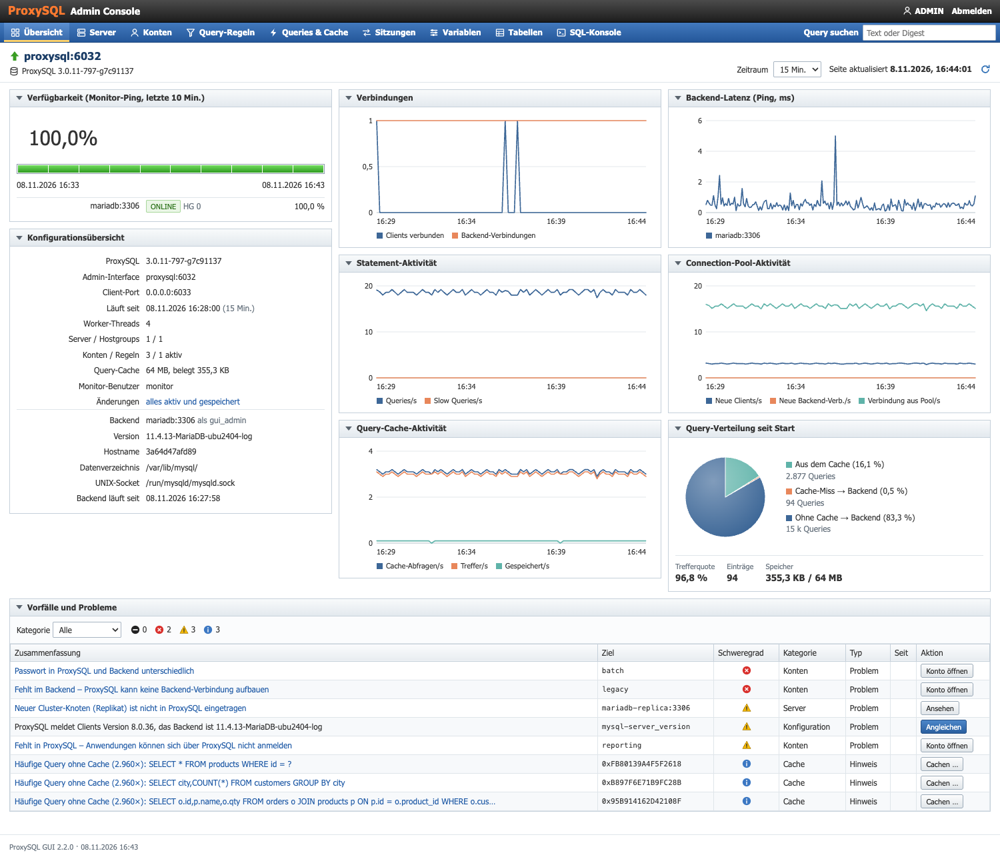

# Release Notes

## 2.2.0 – 8. November 2026

Komplett neu geschriebene ProxySQL-GUI. Aus der einseitigen Tabellenansicht von Version 1 (`proxysql-gui.php`) wird
eine Verwaltungsoberfläche mit Schreibzugriff, Login und Docker-Setups für Test und Produktion. Weiterhin reines PHP
ohne Framework und ohne externe Bibliotheken – läuft also auch in abgeschotteten Netzen.

### Highlights

- **Übersicht** im Stil des Oracle Enterprise Managers: Verfügbarkeit, Live-Diagramme und eine Liste
  „Vorfälle und Probleme“, bei der sich die meisten Probleme direkt per Klick beheben lassen.
- **Kontenabgleich ProxySQL ↔ MariaDB/MySQL:** fehlende Konten und abweichende Passwörter erkennen, Konten in beiden
  Systemen anlegen und alles in einem Rutsch abgleichen (wie `proxysql-admin --syncusers`) – ohne die Passwörter zu kennen.
- **Cluster-Erkennung:** neue Replikate, Galera- und Group-Replication-Knoten finden und in ProxySQL aufnehmen
  (wie `proxysql-admin --update-cluster`).
- **Automatischer Abgleich** von Konten, Passwörtern und Cluster-Knoten über einen Sync-Container oder Cronjob – wahlweise.
- **Query-Cache per Klick** mit Simulation der Regelkette.
- **Konfigurationsabgleich:** zeigt Zeile für Zeile, was im Speicher anders ist als zur Laufzeit oder auf Disk.
- **Docker-Setups** für Test (mit Demo-Daten und Replikat) und Produktion (gehärtet, ohne Standardpasswörter).

### Neu im Detail

**Übersicht**
- Verfügbarkeit der Backends aus dem Monitor-Ping, Konfigurationsübersicht von ProxySQL und Backend.
- Diagramme für Verbindungen, Queries/s, Query-Cache, Backend-Latenz und Connection-Pool (15 Minuten bis 7 Tage),
  Verteilung Cache ↔ Backend. Lücken in der Historie (z. B. nach einem Neustart) werden als Lücke gezeichnet.
- Vorfälle: Server nicht ONLINE, Monitor-Fehler, fehlender Monitor-Benutzer, Kontenprobleme, neue oder verschwundene
  Cluster-Knoten, abweichende Server-Version, Regeln auf leere Hostgroups, nicht aktivierte oder nicht gespeicherte
  Konfiguration, Cache-Regeln ohne Treffer, häufige Queries ohne Cache.

**Konten**
- Abgleich `mysql_users` ↔ `mysql.user` über den `mysql_native_password`-Hash: fehlt in ProxySQL, fehlt im Backend,
  Passwort abweichend, nur `localhost`, Standard-Hostgroup ohne ONLINE-Server.
- Konto in beiden Systemen anlegen (mit Rechte-Vorlagen), Backend-Konto nach ProxySQL übernehmen und umgekehrt,
  Passwort in beiden Systemen setzen, Rechte vergeben und entziehen.
- Sammel-Abgleich Backend → ProxySQL: fehlende übernehmen, Passwörter angleichen, auf Wunsch nur in ProxySQL
  vorhandene löschen. Nicht übertragbare Konten (`caching_sha2_password`, `ed25519`, `unix_socket` …) werden mit Grund
  übersprungen, reine Replikationskonten ignoriert.

**Server und Cluster**
- Server mit Laufzeit-Status und Connection-Pool, Online/Offline schalten, Replikations-Hostgroups, Monitor-Fehler.
- Cluster-Erkennung für MariaDB/MySQL-Replikation, Galera und Group Replication; legt bei Bedarf die
  Replikations-Hostgroup an.
- Die Version, die ProxySQL den Clients meldet (`mysql-server_version`), mit einem Klick an das Backend angleichen.

**Queries, Cache und Regeln**
- Query-Digests mit Laufzeiten, Zeilen und Cache-Anteil; die Regelkette wird je Digest simuliert.
- „Cachen“ legt eine Cache-Regel an und sortiert sie vor eine `apply`-Regel ein, die sonst vorher greifen würde.
- Alle Felder von `mysql_query_rules` bearbeiten, Treffer und Laufzeit-Status je Regel.

**Konfiguration**
- Jede Änderung wird sofort aktiviert (`LOAD … TO RUNTIME`) und gespeichert (`SAVE … TO DISK`).
- Konfigurationsabgleich Speicher ↔ Laufzeit ↔ Disk für alle Module, mit Aktivieren, Speichern und Verwerfen.
- Seite „Tabellen“ für Scheduler, ProxySQL-Cluster, Galera-/Group-Replication-/Aurora-Hostgroups,
  Hostgroup-Attribute, SSL je Server, Fast Routing und Firewall – Formulare aus dem Tabellenschema von ProxySQL.
- Globale Variablen filtern und ändern, Sitzungen ansehen und beenden, SQL-Konsole für ProxySQL und Backend.

**Zugriff und Sicherheit**
- Login mit Session und CSRF-Schutz für alle Formulare; alle Ausgaben werden escaped.
- Zweites Login nur zum Lesen – ohne SQL-Konsole und ohne Zugriff auf Passwörter.
- Nur-Lesen-Modus für alle (`GUI_READONLY=1`); ohne `GUI_PASSWORD` ist die GUI automatisch nur lesend.
- Passwörter und `SHOW GRANTS` werden nie mit Hashes angezeigt.

**Betrieb**
- `docker-compose.yml` – Test-Umgebung: MariaDB mit Replikat, ProxySQL, GUI und Lastgenerator, mit absichtlich
  eingebauten Problemen zum Ausprobieren.
- `docker-compose.prod.yml` – Produktion: nur die GUI gegen ein bestehendes ProxySQL, optional mit ProxySQL und
  Sync-Container. Pflichtwerte ohne Standard, GUI nur auf `127.0.0.1`, schreibgeschütztes Container-Dateisystem,
  minimale Rechte, Healthchecks, Logs an Syslog.
- Automatische Tests in GitHub Actions: Syntax (PHP 8.1 und 8.4), ShellCheck, ein End-to-End-Test, der die Demo
  im Test-Stack durchspielt, und eine Prüfung des Prod-Setups.
- Läuft auch auf dem Handy.

### Umstieg von Version 1

- `proxysql-gui.php` gibt es nicht mehr. Document-Root ist jetzt das Verzeichnis `src/`; `src/lib/`, `src/pages/`,
  `src/bin/` und `config*.php` dürfen nicht direkt abrufbar sein (Apache-Beispiel in `docker/gui/Dockerfile`).
- Zugangsdaten stehen nicht mehr im PHP-Code, sondern in Umgebungsvariablen (`PROXYSQL_HOST`, `PROXYSQL_USER`,
  `PROXYSQL_PASSWORD` …) oder in `src/config.local.php`.
- Version 1 hatte keinen Login. Version 2 braucht `GUI_PASSWORD`, sonst ist sie nur lesend und ohne SQL-Konsole.
- Version 1 las `stats_mysql_query_digest_reset` und hat die Digest-Statistik damit bei jedem Aufruf zurückgesetzt.
  Version 2 liest die Statistik nur; zurückgesetzt wird ausschließlich über den Knopf „Statistik zurücksetzen“.
- Bulma wird nicht mehr gebraucht.

### Voraussetzungen

- PHP 8.1 oder neuer mit `mysqli` – oder Docker.
- Ein ProxySQL-Admin-Benutzer, der sich übers Netz anmelden darf (der Benutzer `admin` darf nur lokal).
- Für Kontenabgleich und Cluster-Erkennung ein Backend-Benutzer, am einfachsten mit
  `ALL PRIVILEGES ON *.* … WITH GRANT OPTION` (siehe README, „Produktivbetrieb mit Docker“).

### Bekannte Einschränkungen

- Getestet mit ProxySQL 3.0.11 und 3.0.12 sowie MariaDB 11.4; ProxySQL 2.x und MySQL 8 sind nicht getestet.
- Galera und Group Replication sind nach Dokumentation umgesetzt, aber nicht gegen einen echten Cluster getestet.
- MySQL 8 mit `caching_sha2_password`: ProxySQL braucht das Passwort im Klartext, der Passwortvergleich ist dann nicht möglich.
- Kontenabgleich und Cluster-Erkennung arbeiten gegen ein Backend.
- Von den PostgreSQL-Funktionen in ProxySQL 3 sind nur die `pgsql-`-Variablen abgedeckt.

Ausführlich: [README](README.md).
